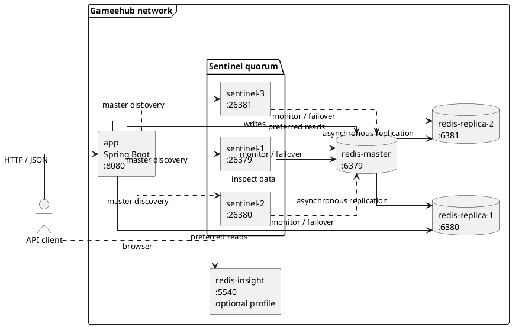

# GameHub

REST API на Kotlin и Spring Boot, использующий Redis как основное хранилище данных.

## Запуск

Для запуска необходимы Docker и Docker Compose. Приложение и весь Redis-кластер поднимаются одной
командой:

```bash
docker compose up -d --build
```

Дождитесь, пока контейнер `gamehub-app` станет healthy:

```bash
docker compose ps
curl http://localhost:8080/actuator/health
```

После запуска REST API доступен по адресу `http://localhost:8080`. Заполнить Redis демонстрационными
данными можно скриптом:

```bash
./scripts/setup.sh
```

Redis Insight запускается отдельно и открывается по адресу `http://localhost:5540`:

```bash
docker compose --profile insight up -d redis-insight
```

Для остановки контейнеров с сохранением данных выполните:

```bash
docker compose down
```

Чтобы остановить проект и удалить все данные Redis из Docker volumes:

```bash
docker compose down -v
```

## Архитектура



Приложение подключается к Redis через кластер из трёх Sentinel. Записи направляются на текущий
master, а чтение выполняется в режиме `REPLICA_PREFERRED`. Master асинхронно реплицирует данные на
две read-only реплики. Если master становится недоступен, Sentinel quorum выбирает новую
master-ноду, после чего приложение автоматически обновляет соединение.

| Данные         | Redis key           | Структура         |
|----------------|---------------------|-------------------|
| Профиль игрока | `player:{id}`       | Hash              |
| Счётчик входов | `logins:{id}`       | String с TTL      |
| Кеш профиля    | `cache:player:{id}` | String/JSON с TTL |
| Лидерборд      | `tournament:main`   | Sorted Set        |
| Достижения     | `achievements:{id}` | Set               |
| Уведомления    | `notifications`     | Stream            |

Контейнеры проекта:

| Компонент         |  Порт | Назначение                           |
|-------------------|------:|--------------------------------------|
| `app`             |  8080 | Spring Boot REST API                 |
| `redis-master`    |  6379 | Redis master                         |
| `redis-replica-1` |  6380 | Первая read-only реплика             |
| `redis-replica-2` |  6381 | Вторая read-only реплика             |
| `sentinel-1`      | 26379 | Первый Sentinel                      |
| `sentinel-2`      | 26380 | Второй Sentinel                      |
| `sentinel-3`      | 26381 | Третий Sentinel                      |
| `redis-insight`   |  5540 | Опциональный интерфейс Redis Insight |
