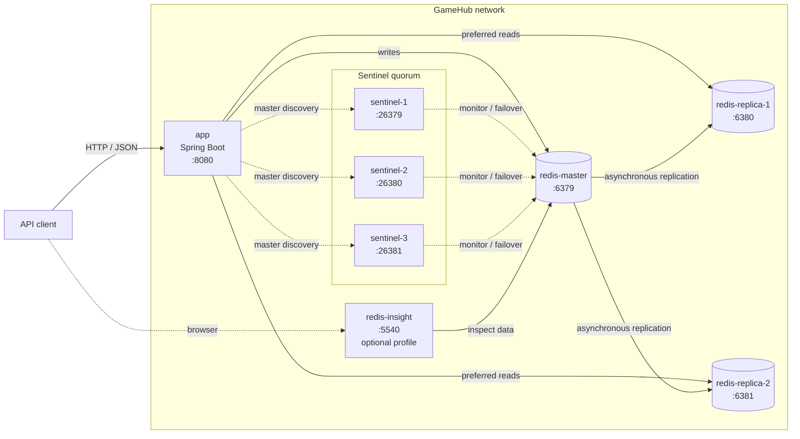

# GameHub

REST API на Kotlin и Spring Boot, использующий Redis как основное хранилище данных.

## Запуск

Для запуска необходимы Docker и Docker Compose. Приложение и весь Redis-кластер поднимаются одной
командой:

```bash
docker compose up -d --build
```

Дождитесь, пока контейнер `gamehub-app` станет healthy:

```bash
docker compose ps
curl http://localhost:8080/actuator/health
```

После запуска REST API доступен по адресу `http://localhost:8080`. Заполнить Redis демонстрационными
данными можно скриптом:

```bash
./scripts/setup.sh
```

Redis Insight запускается отдельно и открывается по адресу `http://localhost:5540`:

```bash
docker compose --profile insight up -d redis-insight
```

Для остановки контейнеров с сохранением данных выполните:

```bash
docker compose down
```

Чтобы остановить проект и удалить все данные Redis из Docker volumes:

```bash
docker compose down -v
```

## API

| Метод   | Endpoint                                       | Назначение                                         |
|---------|------------------------------------------------|----------------------------------------------------|
| `POST`  | `/api/players/batch`                           | Создать от 10 до 100 профилей через Redis Pipeline |
| `POST`  | `/api/players/{id}`                            | Создать или обновить профиль игрока                |
| `GET`   | `/api/players/{id}`                            | Получить профиль игрока через cache-aside          |
| `PATCH` | `/api/players/{id}/level`                      | Изменить уровень игрока и опубликовать уведомление |
| `POST`  | `/api/players/{id}/login`                      | Увеличить суточный счётчик входов                  |
| `POST`  | `/api/players/{id}/achievements`               | Добавить игроку достижение                         |
| `GET`   | `/api/players/{id}/achievements/{name}`        | Проверить наличие достижения                       |
| `GET`   | `/api/players/{id1}/achievements/common/{id2}` | Получить общие достижения двух игроков             |
| `POST`  | `/api/leaderboard/score`                       | Начислить игроку очки                              |
| `GET`   | `/api/leaderboard/top?limit=10`                | Получить игроков с наибольшим количеством очков    |
| `GET`   | `/api/leaderboard/rank/{playerId}`             | Получить позицию игрока через ZRANK                |

### Примеры запросов и ответов

<details>
<summary><code>POST /api/players/batch</code></summary>

Запрос:

~~~json
{
  "players": [
    {
      "id": "1001",
      "name": "Alice",
      "level": 10,
      "region": "EU"
    },
    {
      "id": "1002",
      "name": "Bob",
      "level": 8,
      "region": "EU"
    },
    {
      "id": "1003",
      "name": "Carol",
      "level": 14,
      "region": "NA"
    },
    {
      "id": "1004",
      "name": "Dave",
      "level": 6,
      "region": "ASIA"
    },
    {
      "id": "1005",
      "name": "Eve",
      "level": 12,
      "region": "EU"
    },
    {
      "id": "1006",
      "name": "Frank",
      "level": 4,
      "region": "NA"
    },
    {
      "id": "1007",
      "name": "Grace",
      "level": 9,
      "region": "ASIA"
    },
    {
      "id": "1008",
      "name": "Heidi",
      "level": 11,
      "region": "EU"
    },
    {
      "id": "1009",
      "name": "Ivan",
      "level": 7,
      "region": "NA"
    },
    {
      "id": "1010",
      "name": "Judy",
      "level": 13,
      "region": "ASIA"
    }
  ]
}
~~~

Ответ:

~~~json
{
  "created": 10,
  "elapsedMs": 24,
  "pipelined": true
}
~~~

</details>

<details>
<summary><code>POST /api/players/{id}</code></summary>

Пример URL: <code>/api/players/1001</code>

Запрос:

~~~json
{
  "name": "Alice",
  "level": 10,
  "region": "EU"
}
~~~

Ответ:

~~~json
{
  "id": "1001",
  "name": "Alice",
  "level": 10,
  "region": "EU",
  "createdAt": "2026-10-16T12:00:00Z"
}
~~~

</details>

<details>
<summary><code>GET /api/players/{id}</code></summary>

Пример URL: <code>/api/players/1001</code>. Тело запроса отсутствует.

Ответ:

~~~json
{
  "id": "1001",
  "name": "Alice",
  "level": 10,
  "region": "EU",
  "createdAt": "2026-10-16T12:00:00Z"
}
~~~

</details>

<details>
<summary><code>PATCH /api/players/{id}/level</code></summary>

Пример URL: <code>/api/players/1001/level</code>

Запрос:

~~~json
{
  "delta": 2
}
~~~

Ответ:

~~~json
{
  "id": "1001",
  "name": "Alice",
  "level": 12,
  "region": "EU",
  "createdAt": "2026-10-16T12:00:00Z"
}
~~~

</details>

<details>
<summary><code>POST /api/players/{id}/login</code></summary>

Пример URL: <code>/api/players/1001/login</code>. Тело запроса отсутствует.

Ответ:

~~~json
{
  "playerId": "1001",
  "count": 1,
  "ttlSeconds": 86399
}
~~~

</details>

<details>
<summary><code>POST /api/players/{id}/achievements</code></summary>

Пример URL: <code>/api/players/1001/achievements</code>

Запрос:

~~~json
{
  "achievementName": "FIRST_WIN"
}
~~~

Ответ:

~~~json
{
  "playerId": "1001",
  "achievement": "FIRST_WIN",
  "added": true
}
~~~

</details>

<details>
<summary><code>GET /api/players/{id}/achievements/{name}</code></summary>

Пример URL: <code>/api/players/1001/achievements/FIRST_WIN</code>. Тело запроса отсутствует.

Ответ:

~~~json
{
  "playerId": "1001",
  "achievement": "FIRST_WIN",
  "present": true
}
~~~

</details>

<details>
<summary><code>GET /api/players/{id1}/achievements/common/{id2}</code></summary>

Пример URL: <code>/api/players/1001/achievements/common/1002</code>. Тело запроса отсутствует.

Ответ:

~~~json
{
  "firstPlayerId": "1001",
  "secondPlayerId": "1002",
  "achievements": [
    "FIRST_WIN",
    "LEVEL_10"
  ]
}
~~~

</details>

<details>
<summary><code>POST /api/leaderboard/score</code></summary>

Запрос:

~~~json
{
  "playerId": "1001",
  "score": 150
}
~~~

Ответ:

~~~json
{
  "playerId": "1001",
  "score": 150
}
~~~

</details>

<details>
<summary><code>GET /api/leaderboard/top</code></summary>

Пример URL: <code>/api/leaderboard/top?limit=10</code>. Тело запроса отсутствует.

Ответ:

~~~json
[
  {
    "position": 1,
    "playerId": "1001",
    "score": 150
  },
  {
    "position": 2,
    "playerId": "1002",
    "score": 120
  }
]
~~~

</details>

<details>
<summary><code>GET /api/leaderboard/rank/{playerId}</code></summary>

Пример URL: <code>/api/leaderboard/rank/1001</code>. Тело запроса отсутствует.

Ответ:

~~~json
{
  "playerId": "1001",
  "rank": 0,
  "place": 1,
  "order": "ASC"
}
~~~

</details>

## Архитектура



Приложение подключается к Redis через кластер из трёх Sentinel. Записи направляются на текущий
master, а чтение выполняется в режиме `REPLICA_PREFERRED`. Master асинхронно реплицирует данные на
две read-only реплики. Если master становится недоступен, Sentinel quorum выбирает новую
master-ноду, после чего приложение автоматически обновляет соединение.

| Данные         | Redis key           | Структура         |
|----------------|---------------------|-------------------|
| Профиль игрока | `player:{id}`       | Hash              |
| Счётчик входов | `logins:{id}`       | String с TTL      |
| Кеш профиля    | `cache:player:{id}` | String/JSON с TTL |
| Лидерборд      | `tournament:main`   | Sorted Set        |
| Достижения     | `achievements:{id}` | Set               |
| Уведомления    | `notifications`     | Stream            |

Контейнеры проекта:

| Компонент         |  Порт | Назначение                           |
|-------------------|------:|--------------------------------------|
| `app`             |  8080 | Spring Boot REST API                 |
| `redis-master`    |  6379 | Redis master                         |
| `redis-replica-1` |  6380 | Первая read-only реплика             |
| `redis-replica-2` |  6381 | Вторая read-only реплика             |
| `sentinel-1`      | 26379 | Первый Sentinel                      |
| `sentinel-2`      | 26380 | Второй Sentinel                      |
| `sentinel-3`      | 26381 | Третий Sentinel                      |
| `redis-insight`   |  5540 | Опциональный интерфейс Redis Insight |
